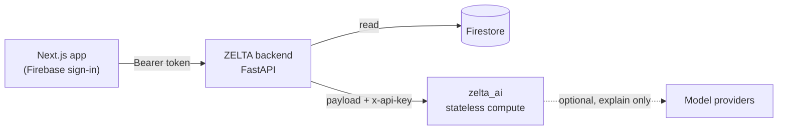

<div align="center">

# ZELTA
### A financial twin for people with irregular money

**Math first. AI explains the result.**

</div>

ZELTA tells you, in plain days, **how long your money lasts**, and checks a spend **before** you make it. You tell it your balance, income, spending and upcoming bills; deterministic engines work out your runway, forecast and a safe amount to spend; an optional language model only explains the result. It never moves money.

It started with Nigerian university students, whose money arrives in lumps and runs out before the next one, and is being widened to anyone with tight, irregular money.

> **Status: working prototype.** Data is self-reported, no live bank connection exists, and every threshold is a proposal that has not been validated on real users. See [Limitations](#limitations).

## What you can do in the app

| Screen | What it does |
|---|---|
| **Path** | A short path of money steps (add bills, log money, cover a week, set money aside) with a daily check-in streak |
| **Twin** | Runway in days, balance as "cloth" (free, cushion, bills), 28-day spending, upcoming bills, suggestions |
| **Before you spend** | Type an amount; get Go ahead / Careful / Hold off with the reasons |
| **What if** | Re-run your forecast with one change (spend less, set aside, receive money, unexpected cost) |
| **Coach** | Ask in your own words; answers come from the engines, with follow-up chips |
| **Earn** | Options ranked by your runway, each with its source and risk. Nothing is invented |

## Principles

* **Math first.** Money is integer kobo, time is explicit (Africa/Lagos), engines are pure functions. A model never calculates; if its text contains a number the engines did not produce, it is discarded.
* **Unknown stays unknown.** Too little data returns a reason, never a zero or a guess.
* **No fabrication.** No invented opportunities, returns, bank connectivity or Mono success. Data is labelled `self_reported`.
* **You stay in control.** No tool moves money.

## Architecture



The browser never talks to the compute service. The backend authenticates the user, builds their data and calls the compute service with an internal key; the service stores nothing.

```
app/ components/ lib/ public/   Next.js 16 frontend (React 19, Tailwind 4, TypeScript)
zelta_backend/                  FastAPI + Firestore: auth, wallet, profile, gig board, /api/twin* bridge
zelta_ai/                       Compute service
  domain/ ledger/               Money (kobo), Lagos clock, event normalisation
  engines/                      burn, runway, position, genome, forecast, buffer,
                                recommendations, guardian, whatif
  financial_twin/ providers/    TwinSnapshot; provider contract (mock, inline, Mono scaffold)
  openbanking/ assurance/       consent, audit, redaction, webhook auth, link flow; identity assurance
  agent_tools/ agents/ llm/     typed tool registry, orchestrator, optional provider adapter
  opportunities/                provenance-checked ranking of a supplied catalogue
  api/                          HTTP contract (api/compute.py)
scripts/local_e2e/              real backend + compute service on localhost for end-to-end checks
```

### Compute API (internal, `x-api-key` + `x-user-id`)

`POST /brain/v1/twin/compute` · `/guardian` · `/whatif` · `/opportunities` · `/agent`

### Backend API used by the app

`GET /api/twin` · `POST /api/twin/guardian` · `/whatif` · `/agent` · `GET /api/twin/opportunities` · plus `/api/wallet`, `/api/profile`, `/api/copilot`, `/api/gig`, `/api/simulation`.

## Build log

| Day | Delivered |
|---|---|
| 1 | Audit; `/dev` routes closed unless `APP_ENV=local`; secure-by-default compute service |
| 2-4 | Money and time, ledger rules, burn and runway with dated bills |
| 5 | First typed endpoint with `{code, message}` errors |
| 6-9 | Position, spending habits, forecast, minimum-safe buffer |
| 10-12 | Recommendations, Guardian, what-if |
| 13 | Opportunities over HTTP; open gigs mapped as `sourced`, unverified entries |
| 14 | Bank-link lifecycle (consent, audit, webhook, withdraw), tested with fakes only |
| 15 | Earn screen ranked by the Twin |
| UI | "Adire" visual language, landing page, frontend verified against the real backend over HTTP |

## Run it

```bash
# Tests
python -m pytest zelta_ai/tests/twin zelta_ai/tests/test_security_defaults.py \
  zelta_ai/tests/test_route_hardening.py zelta_ai/tests/test_llm_adapter.py zelta_ai/tests/test_copilot_provider.py
python -m pytest zelta_backend/tests

# Frontend with sample data (no backend, no login)
cp .env.example .env.local && echo "NEXT_DEMO=1" >> .env.local
pnpm install && pnpm dev

# Frontend against a real backend and AI service on this machine
# see scripts/local_e2e/README.md
```

Environment variables: see [`.env.example`](.env.example). Backend: `INTERNAL_API_KEY`, `AI_BRAIN_URL`, `ALLOWED_ORIGINS` (set to the site origin in production). Compute service: `INTERNAL_API_KEY`, optional `LLM_PROVIDERS`.

## Documentation

* [`zelta_ai/docs/ZELTA_Technical_Documentation.pdf`](zelta_ai/docs/ZELTA_Technical_Documentation.pdf): architecture, engines, API, security, limitations
* [`zelta_ai/docs/FRONTEND.md`](zelta_ai/docs/FRONTEND.md), [`LLM_ADAPTER.md`](zelta_ai/docs/LLM_ADAPTER.md), [`SECURITY.md`](zelta_ai/docs/SECURITY.md), [`PENTEST.md`](zelta_ai/docs/PENTEST.md), [`REGULATORY_MATRIX.md`](zelta_ai/docs/REGULATORY_MATRIX.md), [`AUDIT_DAY1.md`](zelta_ai/docs/AUDIT_DAY1.md), [`RESEARCH.md`](zelta_ai/docs/RESEARCH.md)

## Limitations

* **No live bank data has ever flowed through this code.** The Mono adapter is a scaffold: its field mapping, endpoints and event names are unverified, and no code exchange is wired. Balances and transactions are self-reported.
* **Thresholds are proposals** (blend weights, minimum-safe rules, scenario multipliers), tested on synthetic data only.
* **Consent and audit stores are in memory.** Persistent, encrypted storage is required before real bank data.
* Firebase sign-in and Firestore were not covered by automated end-to-end runs; those steps were faked locally.
* The backend data model is still partly student-specific; goals and income streams are not yet fed into the twin.
* Legacy `brain/` logic still serves some routes. Not financial or legal advice, and no regulatory compliance is claimed. Rotate the old internal API key that remains in git history.

## Team

Team ZELTA, led by Tioluwanimi Adeagbo. Security reports: see [`SECURITY.md`](SECURITY.md).
