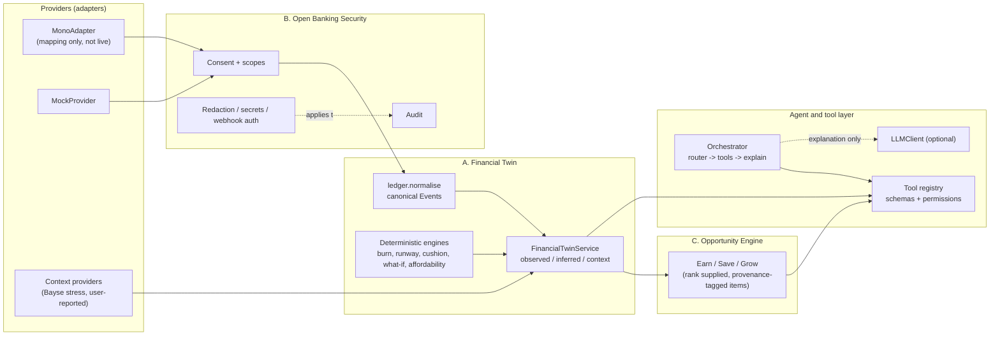

<div align="center">

# ZELTA
### A financial twin for people with irregular money

**Math first. AI explains the result.**

[](https://zelta-878473667930.europe-west1.run.app)
[](https://zelta-878473667930.us-central1.run.app/docs)

</div>

---

## What ZELTA is

ZELTA connects to a person's money but does not hold it. It builds a **Financial Twin**: what is observed (accounts, balances, transactions), what can be derived from it (daily spend, runway, emergency cushion), and what outside context is known, each kept separate and labelled with how sure we are. It started with Nigerian university students, whose income arrives in lumps (allowance, bursary, transfers) and runs out before the next one. It is moving toward anyone with irregular income.

The problem: people do not know how long their money lasts, and tools that only show a balance cannot say whether a purchase is safe.

## Philosophy: math first, AI explains the result

A language model never calculates a balance, a runway or whether a scenario is feasible. Deterministic engines do that, with integer money and an explicit reference time. The AI layer chooses which tools to run, asks follow-up questions, and explains results in plain language. If its explanation contains a figure the engines did not produce, it is discarded and a deterministic template is used.

Unknown stays unknown: too little history, a stale balance or a failed provider produces an explicit "insufficient evidence", never a zero and never a guess presented as fact.

## Status in one paragraph

The deterministic core, the provider contract, the security boundary, the opportunity contract and the agent/tool layer are implemented and tested (see [Verification](#running-tests)). **They are not yet wired into the HTTP routes**: the running services still use the older `brain/` logic. **Mono is not live**: it exists as a validated mapping layer plus a mock; no real bank connection has been made. Many constants are proposals that have not been validated on real data ([`zelta_ai/docs/RESEARCH.md`](zelta_ai/docs/RESEARCH.md)). Do not collect real bank data before the items in [`zelta_ai/docs/SECURITY.md`](zelta_ai/docs/SECURITY.md) are done.

## Architecture



### Subsystem A: Financial Twin

* **Internal financial data.** Provider rows become canonical `Event`s in `ledger/normalise.py`: signed integer `Money` (kobo for NGN), status (`pending`, `posted`, `reversed`, `failed`), kind (`income`, `expense`, `transfer_own`, `reversal`), optional category and confidence, provenance (provider, provider reference, hash of the **untouched original payload**) and a list of missing fields. Rules: duplicates collapse on an idempotency key; a posted row replaces a pending one; a reversal marks its original; equal-and-opposite rows between the user's own accounts are paired as transfers and kept out of income and spending; unusable rows (missing amount, naive or future timestamp, unknown status) are returned with a reason, not dropped silently. Currencies never mix.
* **Provider abstraction.** `providers/base.py` defines `FinancialProvider` (list accounts, fetch transactions, refresh, revoke) and normalised errors (`AuthRejected`, `RateLimited`, `Unavailable`, `InvalidResponse`, `NotConfigured`, `ReauthRequired`). Core code never imports a provider. A second provider is a new subclass; nothing else changes.
* **Mono: actual status.** `providers/mono.py` validates and maps Mono-shaped data and normalises errors. With no credentials or transport it raises `NotConfigured`. No live call has been made; endpoint paths, the auth header and the field semantics (amount in kobo, no pending state) are **unverified** and marked so in the file. The existing `zelta_backend/routes/mono.py` is a seeded simulation.
* **External context.** `providers/context.py`: `ContextSignal` with source, origin (`verified_provider`, `user_reported`, `model_inferred`), observation time, shelf life, optional confidence and consent scope. A signal with no stated shelf life is never treated as fresh. Missing or failing context is absent, not zero, and never feeds the maths. Included: user-reported context and a wrapper for the existing Bayse stress monitor (injected, no network at import).
* **Composition.** `financial_twin/twin.py` returns a `TwinSnapshot`: `observed`, `inferred` (burn with confidence, essential spend, income stability, cushion with stated assumptions, runway), `context_fresh` / `context_stale`, and `warnings`. `snapshot.simulate(...)` is the only place hypothetical outcomes are produced.
* **Engines** (`engines/`, pure functions, no clock, no network): `burn` (divides by covered days, refuses below 7), `runway` (day-by-day forecast, three cases, what-if), `cushion` (stability, cushion, safe flexible spend), `affordability` (within safe flexible / uses cushion / exceeds money / unknown).

### Subsystem B: Open Banking security boundary

Implemented: consent lifecycle and scope checks, fail-closed withdrawal, `SecretStr`, redaction of secrets/account numbers/financial fields, constant-time webhook secret and HMAC checks, redacted audit log, provider response validation, tool permissions. **Still required** before real bank data: live Mono verification, encrypted persistent storage, webhook replay protection and routes, rate limiting, regulatory review (CBN open-banking rules, NDPA 2023). Full table: [`zelta_ai/docs/SECURITY.md`](zelta_ai/docs/SECURITY.md). This is not a compliance claim.

**Identity assurance (`assurance/`).** Not regulated KYC (ZELTA does not hold money): a proportionate trust layer. It compares a claim against things that already exist (the name the bank holds vs the name the user gave; a verified institution email; how lived-in the account history is) and stacks independent evidence families into a level (`NONE` to `STRONG`). One contradiction caps the level; stale evidence is ignored; higher levels unlock more tool scopes (step-up), and no level unlocks money movement. An online registry check is only an interface (`RegistryChecker`); none is connected. Thresholds are proposals. Do not store BVN/NIN: keep only the verdict. Details: `zelta_ai/assurance/`.

Testing the platform: see `SECURITY.md` (disclosure policy) and `zelta_ai/docs/PENTEST.md` (how to engage an ethical hacker safely). Regulatory map: `zelta_ai/docs/REGULATORY_MATRIX.md`.

### Subsystem C: Opportunity Engine

Separate from the twin; it only reads a `TwinSnapshot`. Categories: **Earn** (raise income), **Save** (cut avoidable spend), **Grow** (longer-term, hidden until the emergency cushion is covered). An `Opportunity` must declare provenance: `sourced` (needs a source), `estimate` (needs a confidence) or `ai_suggestion` (cannot carry a benefit figure). The baseline engine **generates nothing**: it filters expired items and orders a supplied catalogue with transparent rules. It never moves money. Replace `rank` when research justifies an algorithm.

### Multi-agent and tool layer

`agents/orchestrator.py` routes the request to an intent (keyword router), runs registered tools, then explains. Tools (`agent_tools/`) have strict pydantic schemas (unknown fields rejected), a permission scope, audited calls and stable error codes: `get_financial_summary`, `estimate_runway`, `evaluate_cushion`, `can_afford`, `run_scenario` (scope `twin:simulate`), `list_opportunities`, `ask_user`. No tool moves money. User text, context and model output are untrusted: tools are chosen by the router, never by the text, and text cannot grant permissions. Without an LLM (`NullLLM`) or on any LLM failure, deterministic templates answer. The model interface is `agents/llm.py::LLMClient`; no vendor SDK is wired to it yet.

## Repository structure

```
app/ components/ lib/ public/   Next.js 16 frontend: Money Path, Twin, Coach, Earn, Me (see zelta_ai/docs/FRONTEND.md)
zelta_backend/                  FastAPI + Firebase service: wallet, profile, simulation, Mono/Squad simulations, gig board
  tests/                        Day 1: /dev routes closed by default
zelta_ai/                       AI service
  main.py api/ config/            existing FastAPI app, settings, routes (unchanged except security defaults)
  brain/                        existing Bayse stress, Bayesian/Kelly, NLP, LangGraph agent, Gemini copilot (float-based, legacy)
  vertex/ security.py           existing optimiser; internal-key check (now secure by default)
  domain/                       Money, Lagos time rules, canonical Event/Account/RawTransaction       (new)
  ledger/                       normalise(), total_connected_money()                                   (new)
  engines/                      burn, runway/forecast/what-if, cushion, affordability                  (new)
  providers/                    FinancialProvider, MockProvider, MonoAdapter, context signals          (new)
  openbanking/                  consent, secrets, redaction, webhook auth, audit                       (new)
  assurance/                    layered identity assurance + step-up scope gating                      (new)
  financial_twin/               TwinSnapshot + FinancialTwinService                                    (new)
  opportunities/                Opportunity model + baseline engine                                    (new)
  agent_tools/                  tool registry and the default tools                                    (new)
  agents/                       orchestrator, LLMClient interface                                      (new)
  tests/twin/                   tests for all new packages
  docs/                         AUDIT_DAY1.md, SECURITY.md, RESEARCH.md
```

## Installation and configuration

```bash
# frontend
pnpm install && pnpm dev            # scripts: dev, build, start, lint (package.json)

# AI service (from zelta_ai/)
pip install -r requirements.txt
uvicorn main:app --host 0.0.0.0 --port 8080

# backend (from zelta_backend/)
pip install -r requirements.txt
uvicorn main:app --host 0.0.0.0 --port 8080
```

Both services have a `Dockerfile` (port from `PORT`, default 8080). Environment variables that exist in the code:

| Service | Variable | Purpose |
|---|---|---|
| zelta_ai | `INTERNAL_API_KEY` | required `x-api-key` for callers |
| zelta_ai | `DEBUG` | `true` disables the key check when no key is set and exposes `/docs`. **Default is now `false`** |
| zelta_ai | `PORT`, `GEMINI_API_KEY`, `NEWS_API_KEY`, `BAYSE_PUBLIC_KEY`, `BAYSE_PRIVATE_KEY` | as named (`config/settings.py`) |
| zelta_backend | `APP_ENV` | `/dev/*` token routes exist **only** when this is exactly `local` |
| zelta_backend | `DEBUG`, `ALLOWED_ORIGINS`, `FIREBASE_API_KEY`, `FIREBASE_SERVICE_ACCOUNT_JSON`, `GEMINI_API_KEY`, `INTERNAL_API_KEY` | `config/settings.py` (also `firebase_project_id`, etc. via field names) |

No Mono credentials are read anywhere yet.

## Running tests

```bash
# new packages (Day 2-4) + Day 1 AI security defaults, from zelta_ai/
python -m pytest tests/twin tests/test_security_defaults.py -q
# Day 1 backend, from zelta_backend/
python -m pytest tests -q
```

Needs `pytest`, `fastapi`, `httpx`, `pydantic`; the backend test also needs the backend's requirements. Legacy tests in `zelta_ai/tests/` (`test_brain.py`, `test_ws.py`, `test_bayesian_engine.py`, and four modules that fail to import) were already failing before this work and are unchanged; see `zelta_ai/docs/RESEARCH.md`.

## The build days (1 to 15)

| Day | Objective | Delivered |
|---|---|---|
| 1 | Audit; close the open door | `zelta_ai/docs/AUDIT_DAY1.md`; `/dev` token routes closed unless `APP_ENV=local`; AI service secure by default |
| 2 | Money, time, event type | `domain/` with tests (no floats; Lagos date; naive datetimes rejected) |
| 3 | Ledger rules | `ledger/` dedupe, pending-to-posted, reversals, own transfers, stale policy; Tola total = 53,500 |
| 4 | Burn and runway with dated bills | `engines/`; Tola runway 16.99 days (naive 24.9) |
| 5 | First thin endpoint | `GET /brain/v1/twin` (`api/twin.py`): typed `TwinOut`, `{code, message}` errors only, internal-key auth, 503 until a data source is wired |

| 6 | Current state | `engines/position.py`: inflow/outflow, bills due, availability, goal needs, flexible money (`snapshot.position()`) |
| 7 | Financial Genome ("Your Spending Habits") | `engines/genome.py`: income timing, post-income spend, categories, recurring, weekend and month-end, change; thin data returns reasons, not guesses |
| 8 | Forecast | `engines/forecast_summary.py`: expected balance, likely runout and range, next-income effect, goal trajectory; explicit `as_of` and timezone |
| 9 | Cost buffer | `engines/buffer.py`: minimum safe amount, buffer after bills; the forecast reports the first day it dips below minimum or cushion |

| 10 | Recommendations | `engines/recommendations.py`: deterministic rules, each with `because` and withheld reasons |
| 11 | Guardian | `engines/guardian.py`: PROCEED / CAUTION / PROTECT; now drives the backend intercept check |
| 12 | What-if | `engines/whatif.py`: up to 5 bounded scenarios |
| 13 | Opportunities over HTTP | `POST /brain/v1/opportunities` ranks a caller-supplied catalogue; the backend feeds it open gigs as `sourced` EARN entries (marked unverified). Nothing is generated |
| 14 | Bank-link lifecycle | `openbanking/link.py`: start, complete, sync, webhook, withdraw with consent checks and audit. **Fakes only; no live Mono call has been made** |
| 15 | Earn screen | "Ranked for you" shows source, risk and reasons per option |

Days 6 to 9 follow the build-guide plan (current state, genome, forecast, cost buffer). Thresholds are proposed, not validated. The agent can answer habits, forecast, buffer and position questions through new tools; none of these are exposed on HTTP yet.

Plus the architecture groundwork: providers, security boundary, twin service, opportunity contract, agents and tools. The Tola numbers come from a synthetic fixture, not real users.

## Limitations and assumptions

* The only HTTP route on the new core is `GET /brain/v1/twin`, which returns 503 until a real `TwinRepository` is configured (no fake data is served); legacy `brain/` logic still serves requests and still uses floats and the system clock.
* Mono is mapping-only and unverified. No live bank data has ever flowed through this code.
* Constants (blend weights, thresholds, scenario multipliers) are **proposed**; the forecasting experiments behind them were on synthetic data with one seed.
* "Essential" spend uses a caller-supplied category list; category quality is unresolved.
* Consent and audit stores are in-memory. Two Firestore transaction stores still exist in the legacy backend.
* Known legacy issues (hardcoded key in `zelta_ai/tests/test_brain.py`, `detail=str(e)` leaks, wildcard CORS) are listed in `zelta_ai/docs/AUDIT_DAY1.md`. **Rotate that key** (now read from the environment, but still in git history).

## Roadmap

1. Rotate the leaked internal key (removed from `test_brain.py`, but still in git history).
2. Implement a real `TwinRepository` (Firestore/Mono) and have `zelta_backend` call `/brain/v1/twin` for the signed-in user; migrate the wallet routes to `Money` and one transaction store.
3. Get Mono sandbox credentials; verify paths, fields, pending states, reauth and webhooks; only then flip `is_live`.
4. Persist consent and audit; add webhook route with replay protection.
5. Evaluate forecasting and burn methods on real (consented) data; replace proposed constants with measured ones.
6. Plug a model behind `LLMClient`; add a verified opportunity source.


## LLM adapter and agent
Models are swappable behind `zelta_ai/llm/` (fallback, circuit breaker, shadow mode for retiring third-party models); see `zelta_ai/docs/LLM_ADAPTER.md`. The agent now handles multi-part questions, follow-ups ("what about 20k?"), and an optional whitelisted LLM planner. All numbers still come from the deterministic engines.
